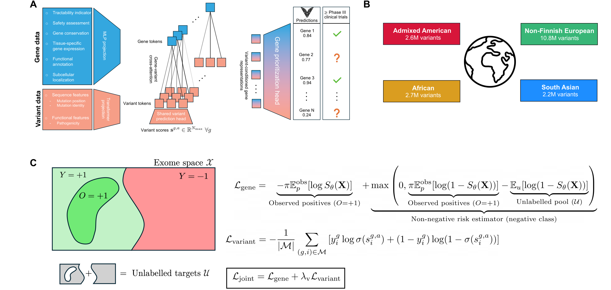

<div align="center">

<picture>
  <source media="(prefers-color-scheme: dark)" srcset="docs/figures/varformer_logo_dark.png">
  
</picture>

# Varformer: a multimodal transformer for population-scale drug target and variant prioritization

[](https://www.python.org/downloads/release/python-390/)
[](LICENSE)
[](https://github.com/aaronwtr/Varformer/actions/workflows/ci.yml)
[](#)
[](https://huggingface.co/aaronw1290/Varformer)

</div>

**Varformer** is a disease-agnostic model that ranks clinically promising targets from gene and population-genetic evidence. A cross-modal attention mechanism combines gene-level biological features with pathogenicity-ranked, masked sets of up to 1,024 missense variants observed in a population. The resulting output is a target-prioritization score associated with selected Phase III/approval labels, not a calibrated probability of programme or clinical-trial success.

The paper trains separate models for four variant catalogues: African/African-American (AFR), Admixed American (AMR), Non-Finnish European (NFE), and South Asian (SAS, via the Genes & Health British Bangladeshi and Pakistani cohort).

<p align="center">
  
</p>

## Installation

```bash
git clone https://github.com/aaronwtr/Varformer.git
cd Varformer
uv sync          # or: pip install -e .
```

Requires Python 3.9 and a CUDA-capable GPU for inference at scale (CPU works for small batches).

## Inference with a trained model

```python
from varformer import Varformer

# Download a released model of the paper (see Released models).
model = Varformer.from_pretrained("nfe", seed="best")

# Rank a list of Ensembl gene IDs with the target-prioritization score.
predictions = model.predict(
    genes=["ENSG00000141510", "ENSG00000139618"],
    return_attention=False,
)
for gene_id, payload in predictions.items():
    print(gene_id, payload["prediction"], payload["classification"])
```

Each `payload` dict contains:

- `prediction` — the model's sigmoid target-prioritization score in `[0, 1]`; interpret its ordering, not its magnitude as a probability.
- `classification` — binary 0/1 from the trained quantile threshold; a value of 0 is not a prediction of programme failure.
- `z_var` — the variant-informed gene embedding (NumPy array).
- `attn_weights` — per-variant attention scores (only when `return_attention=True`).

The `seed` argument accepts an integer (load that specific seed) or `"best"` (pick the highest-scoring checkpoint by `val_spearman`).

### Variant scores

Models trained with the variant head (see [Training with the variant head](#training-with-the-variant-head)) also score individual missense variants:

```python
variant_scores = model.score_variants(genes=["ENSG00000130164"])
payload = variant_scores["ENSG00000130164"]
print(payload["variant_scores"])   # one score per retained variant
```

Each `payload` dict contains NumPy arrays with one entry per retained variant, in the model's token order (descending pathogenicity):

- `variant_scores` — the variant-head score; higher values rank a variant higher.
- `pathogenicity`, `position`, `mutation` — the token inputs, for alignment with the source variant table.

The variant score ranks variants for research prioritization. It is not calibrated or validated for clinical variant classification.

### Released models

The weights of the 25 models in the paper are on the [Hugging Face Hub](https://huggingface.co/aaronw1290/Varformer) under the **CC BY-NC-SA 4.0** license (see [License](#license)). All models were trained with the default settings (see [Training with the variant head](#training-with-the-variant-head)), with five seeds each (13, 23, 42, 85, 482).

| Model | Cohort | Use in the paper |
|---|---|---|
| `afr` | African (gnomAD) | gene prioritization |
| `amr` | Admixed American (gnomAD) | gene prioritization |
| `nfe` | Non-Finnish European (gnomAD) | gene prioritization |
| `sas` | South Asian — Genes & Health (Bangladeshi + Pakistani), N=44,288 | gene prioritization |
| `sas-gnh` | South Asian — Genes & Health | variant scores in the Genes & Health analyses; trained with `geneticConstraint` as an additional gene input |

`Varformer.from_pretrained(model, seed)` downloads the weights and checks them against their SHA-256 checksum. `seed` is one of the five seeds or `"best"`, the seed with the highest validation Spearman correlation. `local_dir` loads a downloaded copy of the release instead. The weights contain no training data: the model inputs are built from your local copies of the input data (see [Data sources](#data-sources)), and `from_pretrained` stops if their dimensions differ from those of the released model.

Models that you train yourself load with `Varformer.from_checkpoint(path)`.

## Model

Following the design in the paper, Varformer is structured around two complementary modules whose representations are fused by cross-modal attention before classification:

- **Gene Characterisation (GC) module** — captures gene-centric biology independent of the population. In the implementation this is split across two parallel MLP projections: one over nine Open Targets tractability and safety features, and one over Gene Ontology-derived features. Their outputs are concatenated into a single gene-level representation `z_gene`. The Open Targets `geneticConstraint` feature is excluded by default (`gc_exclude_features`), because the paper uses it to select the benchmark negatives.
- **Population Variant Characterisation (PVC) module** — encodes a pathogenicity-ranked, masked set of up to 1,024 missense variants observed in a population for each gene. Each variant is represented by its AlphaMissense pathogenicity score, protein position modulo 1,024, and mutation-type index. A small transformer encoder (`VariantEncoder`) produces contextualised variant embeddings. Allele frequency is not a PVC token field in the models of the paper.

`z_gene` then attends over the per-variant embeddings (`GeneVariantAttention`), producing a single variant-informed embedding `z_var`. The classification head concatenates `z_gene` with `z_var` and produces a target-prioritization score.

**Loss.** Targets associated with Phase III development or approval provide selected observed-positive labels; the remaining genes are unlabelled rather than confirmed failures. Training uses a clipped **non-negative positive-unlabelled (nnPU)** objective so that unlabelled genes need not be treated as explicit negatives. Interpreting the learned ordering as clinical promise requires label-selection assumptions and does not make the score a calibrated outcome probability.

## Training on a new exome-seq dataset

To train Varformer on a different population or cohort, the dataset has to be pre-processed into the same per-gene format used by the published populations:

1. **Variants.** A pickle keyed by Ensembl gene ID, where each value is the gene's missense-variant table (columns: AlphaMissense pathogenicity score, protein position, mutation-type index). The mutation-type index is taken from the shared missense map in `data/<pop>/missense_mutation_map.pkl`.
2. **Gene features.** Per-gene Open Targets tractability features and Gene Ontology features, aligned to the same gene index, in the layout expected by `varformer/data/features/gc.py` and `varformer/data/features/go.py`.
3. **Labels.** Observed-positive target labels for PU training; all other genes are treated as unlabelled rather than failed targets.

Register the new population by adding its label to the `Population` literal in `varformer/config.py` and adding its data paths under the appropriate profile in `configs/paths/{local,hpc}.yml`.

Once the data is in place:

```python
from varformer import Varformer

trainer = Varformer.trainer(
    population="<your-label>",
    config_overrides={"variant_labels_path": "variant_labels.parquet", "lr_start": 3e-5},
    output_dir="./checkpoints/",
)
checkpoint_paths = trainer.fit(seeds=[7, 42, 85])
```

`config_overrides` accepts any field from `varformer.config.Hyperparameters`. Each seed produces an independent checkpoint under `output_dir/<your-label>/`.

### Training with the variant head

The variant head is a shared linear layer on the contextual variant tokens. It is trained jointly with the gene objective, `L = L_gene + variant_loss_weight * L_variant`. The defaults are the settings of the paper: `variant_head: True`, `variant_loss_weight: 0.1`, `variant_objective: "pooled_bce"` and `precision: "32-true"`. Training therefore needs a variant label table:

```python
trainer = Varformer.trainer(
    population="sas",
    config_overrides={"variant_labels_path": "variant_labels.parquet"},
)
```

To train without the variant head, set `"variant_head": False` and `"variant_loss_weight": 0.0`.

`variant_labels_path` points to a Parquet table with the columns `variant_id`, `label`, `observed` and `stratum`. In the paper, `label` is 1 when the maximum adjusted allele frequency across the gnomAD v4.1 AFR, AMR, NFE and SAS groups is below 10⁻³ and 0 otherwise; `observed` marks variants with a usable frequency; `stratum` is the substitution class (for example `C>T`). Variant labels on a fixed 15% of genes are withheld from the variant loss for evaluation.

### Training without AlphaMissense

AlphaMissense is released under CC BY-NC-SA 4.0, which does not allow commercial use. The variant encoder reads the pathogenicity score as one number per variant (`nn.Linear(1, ...)`), so you can train a model with another missense predictor instead. **[ESM-1v](https://github.com/facebookresearch/esm)** is a good choice: it is MIT-licensed and scores any variant from the protein sequence. Other predictors (for example EVE, REVEL, PolyPhen-2 or SIFT) also work; check that their licenses allow your use.

1. Score every missense variant in your variant data with the other predictor.
2. Make higher scores mean more damaging variants. For ESM-1v, use the negative log-likelihood ratio. The encoder keeps the 1,024 highest-scoring variants of each gene, so the direction matters.
3. Rescale the scores to the range 0 to 1, the range of AlphaMissense, for example with a rank transform.
4. Write the scores in the layout of the AlphaMissense files: a gzipped, tab-separated file with three comment lines, then a header with the columns `#CHROM`, `POS`, `REF`, `ALT`, `protein_variant` (for example `A123T`) and `am_pathogenicity` (your score). Use the chromosome names of your variant data (for example `chr1`).
5. Save this file as both `<data_root>/alphamissense/AlphaMissense_isoforms_hg38.tsv.gz` and `<data_root>/alphamissense/AlphaMissense_hg38.tsv.gz`. Variants without a score are left out of the model input.
6. Delete `var_pat_features.pkl` and `gene_loc_var_map.pkl` in `<data_root>/features/<population>/`, so that the variant tokens are built again from the new scores.
7. Train with `Varformer.trainer` as above. The variant labels come from allele frequencies, so they do not change.

Use the same predictor at inference as in training, because scores from different predictors are not calibrated to one another. For this reason the released models of the paper **require AlphaMissense scores**: other scores give them out-of-distribution inputs and unreliable predictions.

## Repository layout

```
varformer/         # the importable package
  models/          # VariantEncoder, GeneVariantAttention, Varformer
  training/        # VarformerLightningModule, training loop, callbacks
  inference/       # predict + evaluate entry points
  data/            # features/, parsers/, datasets, samplers, pipeline, loaders, splits
  baselines/       # logistic-regression and random comparison baselines
  utils/           # seeding, aa_codes
  config.py        # Pydantic Config + Hyperparameters
configs/           # default.yml + paths/{local,hpc}.example.yml
scores/            # variant scores from the paper
docs/figures/      # README assets
checkpoints/       # trained model checkpoints (gitignored)
```

## Scores from the paper

| File | Content |
|---|---|
| `scores/gnh_variant_scores.tsv.gz` | Variant scores from the SAS model for missense variants observed in Genes & Health, averaged over five seeds (2,264,706 variant annotations, 1,299,645 GRCh38 variants, 15,725 genes). |

Columns of `gnh_variant_scores.tsv.gz`: `key` (`chrom_pos_ref_alt`, GRCh38), `variant_id` (`key` plus the amino-acid change), `gene` (Ensembl), `s_v` (variant score) and `gene_score` (gene score of the same model). The file contains no genotypes, allele counts, phenotypes or individual-level data.

## Data sources

Varformer is trained on publicly available resources plus the access-controlled Genes & Health cohort. Users replicating or extending training need to obtain these datasets directly from their providers under the providers' respective terms.

| Source | Role in Varformer | Access |
|---|---|---|
| [Open Targets](https://platform.opentargets.org/) | GC module — tractability features | Open, [terms](https://platform-docs.opentargets.org/terms-of-use) |
| [Human Protein Atlas v23](https://v23.proteinatlas.org/) | GC module — UniProt-derived GO terms, subcellular location and tissue protein expression | Open, [licence](https://www.proteinatlas.org/about/licence) |
| [GTEx v10](https://gtexportal.org/) | GC module — tissue RNA expression | Open |
| [AlphaMissense](https://www.science.org/doi/10.1126/science.adg7492) | PVC module — per-variant pathogenicity score | Released under CC BY-NC-SA 4.0 — **non-commercial** |
| [gnomAD v4.1](https://gnomad.broadinstitute.org/) | Population variant catalogues for NFE / AFR / AMR | Open, [licensing](https://gnomad.broadinstitute.org/policies) |
| [Genes & Health](https://www.genesandhealth.org/) | South Asian (SAS) exome cohort | Access-controlled; apply via the G&H Data Access Committee |

The downstream AlphaMissense licence (CC BY-NC-SA 4.0) limits commercial use of Varformer's per-variant features. If you intend to deploy Varformer in a commercial setting, obtain a separate AlphaMissense licence or substitute another missense-pathogenicity predictor.

## Updates

- **Pending** — Release with the paper: the code, the variant scores from the paper and the weights of the 25 paper models on the [Hugging Face Hub](https://huggingface.co/aaronw1290/Varformer).

## Acknowledgements

We thank the participants and operational team of the **Genes & Health** study for the South Asian exome data, and the **Open Targets**, **Gene Ontology Consortium**, **gnomAD / Broad Institute**, and **Google DeepMind (AlphaMissense)** teams for making the underlying resources publicly available.

## Citation

The paper citation will be added when the bioRxiv DOI is available. Until then,
please cite the v1.0.0 software release; machine-readable metadata is provided in
[`CITATION.cff`](CITATION.cff).

```bibtex
@software{wenteler2026varformer,
  title   = {Varformer: a multimodal transformer for population-scale drug target and variant prioritization},
  author  = {Wenteler, Aaron and Neduva, V. and Cabrera, Claudia P. and Wei, W.  and Barnes, Michael R.},
  year    = {2026},
  version = {1.0.0},
  url     = {https://github.com/aaronwtr/Varformer}
}
```

## License

- **Code:** MIT, see [`LICENSE`](LICENSE).
- **Released weights and the variant scores in `scores/`:** [CC BY-NC-SA 4.0](https://creativecommons.org/licenses/by-nc-sa/4.0/). The models take AlphaMissense scores as input, and AlphaMissense is released under CC BY-NC-SA 4.0. So the weights and the scores derived from them are shared under the same terms: attribution, non-commercial use only, and the same license for derived works.
- **Commercial use:** train your own model with a predictor whose license allows it (see [Training without AlphaMissense](#training-without-alphamissense)), or obtain a separate AlphaMissense license.

## Contact

Aaron Wenteler — <aaronwenteler@gmail.com>
